# Rig Conductor user manual

Rig Conductor runs a heat-aggression recording from start to finish: record on
the Motif rig, cut the video into one clip per arena, track the flies on Aoraki,
score the behaviour, and copy the results to a USB disk. A second window, the
**training-data wizard**, grows the labelled frames that teach the pose model and
trains new models on Aoraki.

Every picture in this manual is a real window. The numbered orange circles show
where to click; the list under each picture says what each number does.
Example content (vials, a run on Aoraki, picked frames) was filled in for the
pictures.

## Starting the programs

| What | Desktop icon | Command |
|---|---|---|
| Record and analyse | *Rig Conductor* | `rigconductor gui` |
| Labels and training | *Rig Conductor — training data* | `rigconductor label` |
| Relay on a networked PC | (none) | `rigconductor relay gui` |

You can also open the training-data wizard from the main wizard with the
**Training data…** button at the bottom.

**Help** (bottom left on every page, or **F1**) opens this manual in its own
window, at the section about the page you are on. It has a contents list and a
search box (**Ctrl+F**); you can keep it open beside the wizard.

A recording day goes through six pages: **Setup → Animals → Record → Cut &
check → Analyse → Deliver**. Press **Next** to go on. Every step is saved, so
you can close the program and pick up the same recording later (Setup page,
*Existing recording*).

## 1 · Setup

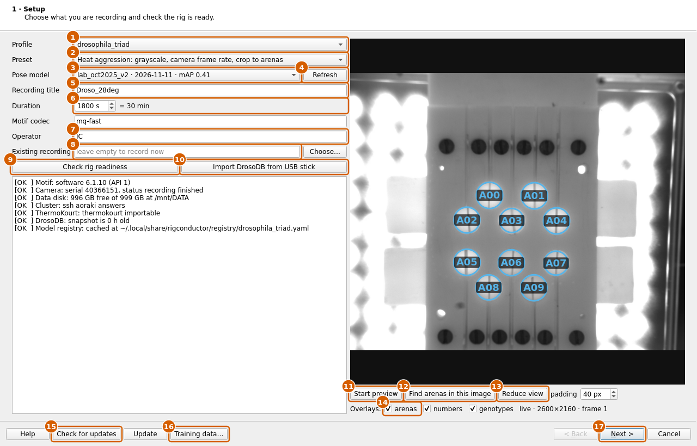

1. **Profile**: what is in the rig. `drosophila_triad` is the fly aggression
   rig (10 arenas, 2 males and a decapitated female each).
2. **Preset**: the kind of experiment. It sets grayscale, frame rate and
   whether the recording is cropped to the arenas afterwards.
3. **Pose model**: the SLEAP model Aoraki will use. The default model is
   chosen for you. The camera is checked against the model straight away and the
   result appears in the report box.
4. **Refresh**: fetches the newest model list from Aoraki.
5. **Recording title**: becomes the start of the recording's folder name, for
   example `Droso_28deg`.
6. **Duration**: how long to record, in seconds (the minutes are shown next to
   it).
7. **Operator**: your initials.
8. **Existing recording**: leave this empty to record now. To analyse a
   recording that already exists, press **Choose…** and pick its folder. If the
   Conductor made that recording, all its settings and vials come back and the
   finished steps are skipped.
9. **Check rig readiness**: checks Motif, the camera, free disk space, the
   connection to Aoraki, ThermoKourt, the DrosoDB copy and the model list. Every
   line should say `[OK  ]`.
10. **Import DrosoDB from USB stick**: brings in the newest vial list. On the
    tablet run *DrosoDB → USB stick* first, then plug the stick in here.
11. **Start preview**: shows the live camera picture.
12. **Find arenas in this image**: looks for the arenas in the live picture.
    Use it to check that the plate sits where it should.
13. **Reduce view**: shows only the area around the arenas. **padding** is the
    margin around them, in camera pixels; the same margin is used when the
    recording is cropped later.
14. **Overlays**: switch the arena circles, the arena numbers and the genotypes
    on the picture on or off.
15. **Check for updates** shows whether a newer version of the Conductor or
    ThermoKourt exists; **Update** (right next to it) installs it. Restart the
    Conductor afterwards.
16. **Training data…** opens the training-data wizard (see below).
17. **Next**: checks the camera against the model once more. If something does
    not fit, a box offers a fix, for example *Convert to grayscale* or *Set
    camera to 69 fps*.

## 2 · Animals

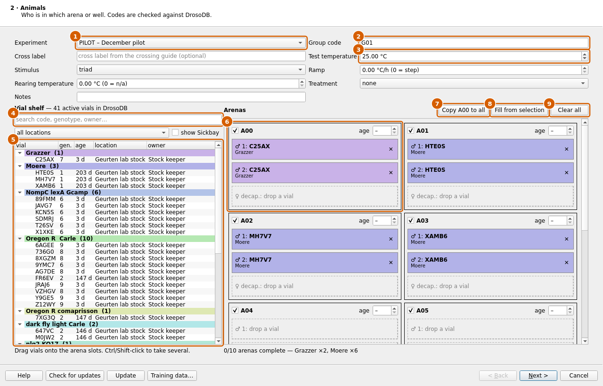

1. **Experiment**: the experiment this recording belongs to.
2. **Group code**: the coded group, for example `G01`. Fill in *Cross label*,
   *Stimulus*, *Ramp*, *Rearing temperature*, *Treatment* and *Notes* where they
   apply.
3. **Test temperature**: the temperature during the test.
4. **Search**: type a vial code, genotype or owner to find a vial.
5. **Vial shelf**: all active vials from DrosoDB, grouped by genotype. Drag a
   vial onto an arena slot. Ctrl-click or Shift-click to drag several at once.
   **show Sickbay** also lists the vials in the Sickbay (hidden otherwise).
6. **Arena card**: one card per arena. The tick says the arena is used. Drop a
   vial on a male slot; one vial fills both male slots. **✕** empties a slot,
   a double-click lets you type a code by hand, **age** is the age in days.
7. **Copy A00 to all**: gives every ticked arena the vials of arena A00.
8. **Fill from selection**: shares the vials selected on the shelf over the
   ticked arenas, in turn.
9. **Clear all**: empties every arena.

The line under the arenas says how many arenas are complete. **Next** refuses
to go on while something required is missing and says what it is.

## 3 · Record

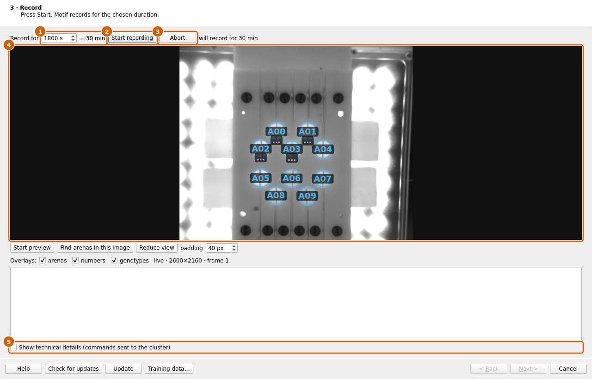

1. **Record for**: the duration again; change it here if needed.
2. **Start recording**: Motif starts recording. The line next to the buttons
   counts the time.
3. **Abort**: stops the recording early.
4. **Live preview**: starts by itself, with the arenas and genotypes drawn on.
5. **Show technical details (commands sent to the cluster)**: also shows the commands sent to Motif and
   Aoraki in the log (for troubleshooting).

**Next** becomes available when the recording has finished.

## 4 · Cut & check

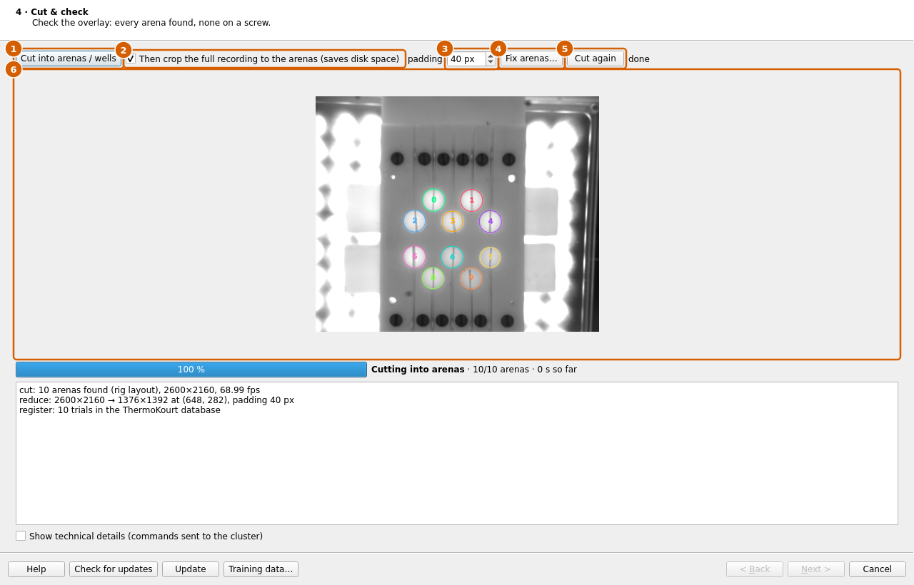

1. **Cut into arenas / wells**: cuts the recording into one clip per arena and
   registers the trials in the ThermoKourt database. The bar shows the progress.
2. **Then crop the full recording to the arenas (saves disk space)**: afterwards the full video
   is replaced by a copy cropped to the arenas. This saves a lot of disk space.
   The cropped copy is checked frame by frame before the full video is deleted.
3. **padding**: the margin kept around the arenas when cropping.
4. **Fix arenas…**: opens the arena editor (next section) when an arena was
   missed or sits on a screw.
5. **Cut again**: throws the clips away and cuts again (the old clips are kept
   in a `clips.old-…` folder).
6. **Arena overlay**: check it. Every arena must have a circle and number, and
   no circle may sit on a screw.

### Fix arenas

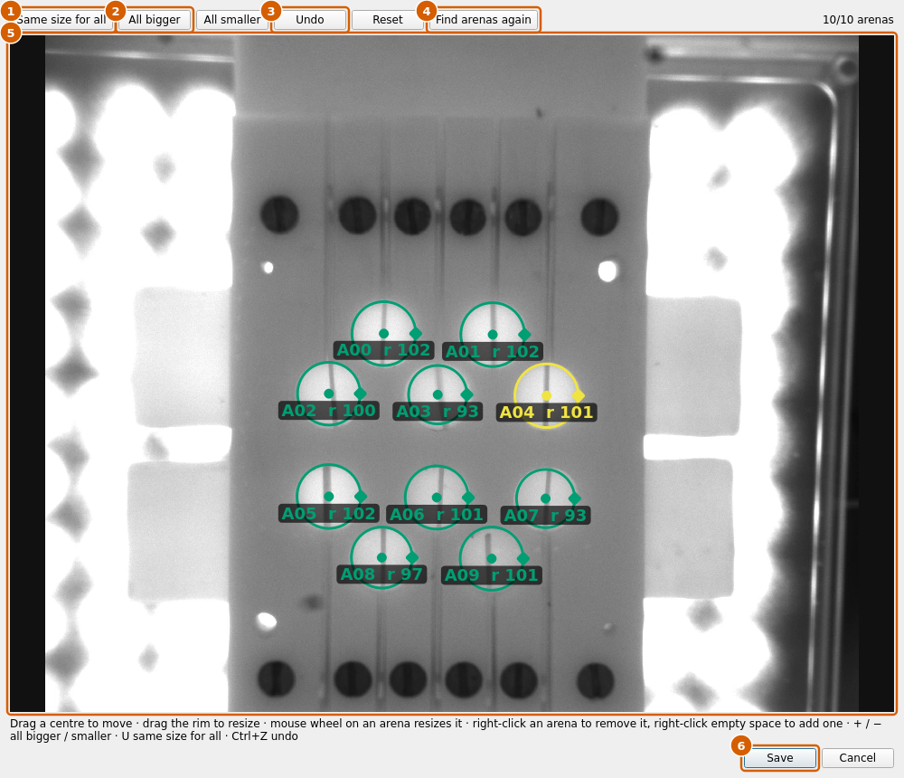

1. **Same size for all**: gives every circle the median size.
2. **All bigger / All smaller**: grows or shrinks every circle a little.
3. **Undo / Reset**: takes back the last change / goes back to the circles
   you started with.
4. **Find arenas again**: detects the arenas on this frame again.
5. **The circles**: drag a centre to move a circle, drag the rim to resize it,
   use the mouse wheel over a circle to resize it. Right-click a circle to remove
   it; right-click empty space to add one. Keys: **+**/**−** all bigger/smaller,
   **U** same size, **Ctrl+Z** undo. The selected circle is yellow.
6. **Save**: keeps the circles. The Conductor then asks whether to cut the
   recording again with them.

The saved circles also become the rig's layout for the next recording.

## 5 · Analyse

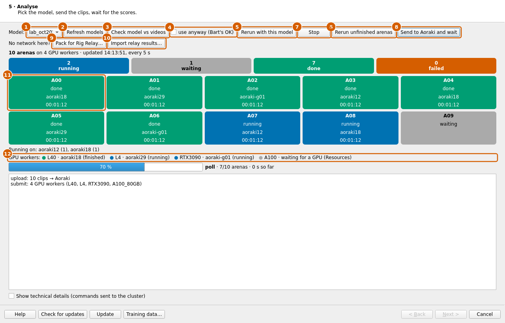

1. **Model**: the pose model for this recording.
2. **Refresh models**: fetches the newest model list from Aoraki.
3. **Check model vs videos**: checks that the clips suit the model (colour,
   frame rate, size).
4. **use anyway (Bart's OK)**: sends the clips even if that check failed.
   Only with Bart's OK.
5. **Rerun with this model**: analyses the recording again with the model
   chosen in 1. The earlier poses are kept in an archive folder; the scores are
   replaced.
6. **Rerun unfinished arenas**: sends only the arenas that have no poses yet.
7. **Stop**: cancels this run on Aoraki. Finished arenas are kept.
8. **Send to Aoraki and wait**: uploads the clips, tracks the flies on the
   GPUs, fetches the poses and scores the behaviour. You can watch it here.
9. **Pack for Rig Relay…**: for a rig without network. Writes a job package to
   a USB stick (see *Rig Relay*).
10. **Import relay results…**: reads the results the relay wrote back to the
    stick. Then press **Send to Aoraki and wait** to score them.
11. **Arena tile**: one tile per arena: blue running, grey waiting, green done,
    orange failed, with the computer and the time. **Click a tile** to see the
    last lines of that arena's log on Aoraki (picture below).
12. **GPU workers**: the graphics cards working on this run. A worker that
    waits says why (for example *Resources*: all cards of that kind are busy).

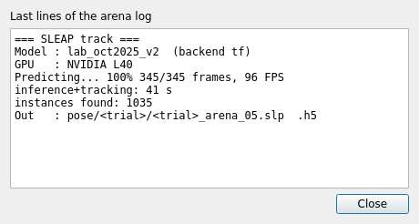

Aoraki tries a failed arena up to 3 times before it gives up. Several kinds of
GPU are used at once; the run is done when every tile is green.

## 6 · Deliver

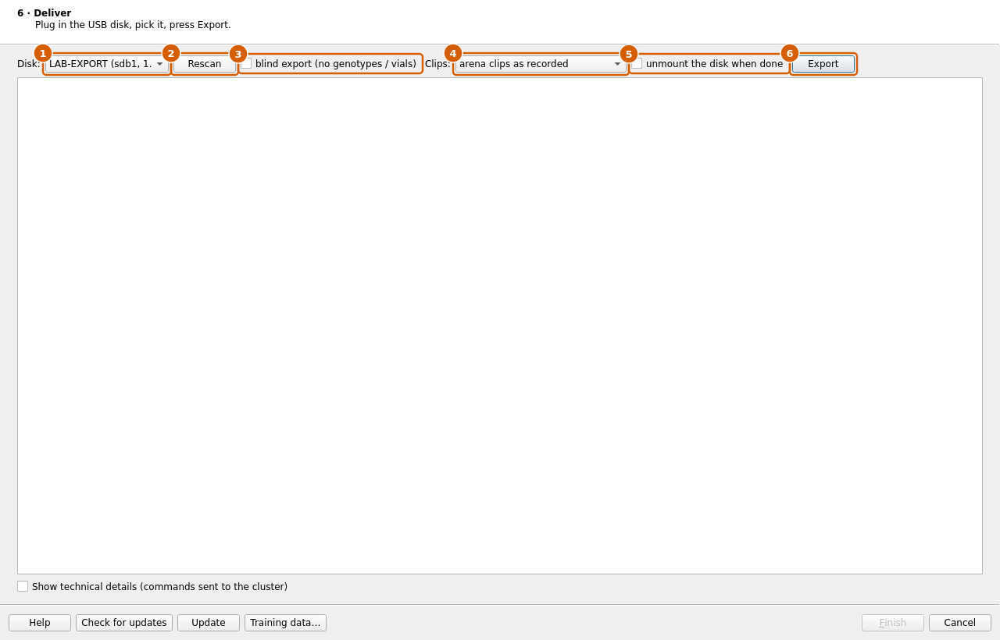

1. **Disk**: the USB disk to copy the results to. Choose *… a folder instead*
   to write to a folder.
2. **Rescan**: looks again after you plugged a disk in.
3. **blind export (no genotypes / vials)**: leaves out genotypes and vial codes, so whoever scores the
   videos does not know the groups.
4. **Clips**: which videos go along: none, the arena clips as recorded, clips
   with the tracked skeletons, with the scored events, or both.
5. **unmount the disk when done**: the disk can be pulled out straight after.
6. **Export**: copies everything.

## Rig Relay (a rig without network)

When the rig PC cannot reach Aoraki, a USB stick carries the work to a PC that
can.

1. On the rig, Analyse page: **Pack for Rig Relay…** writes `<session>.job.zip`
   to the stick.
2. On the networked PC, open the Rig Relay window:

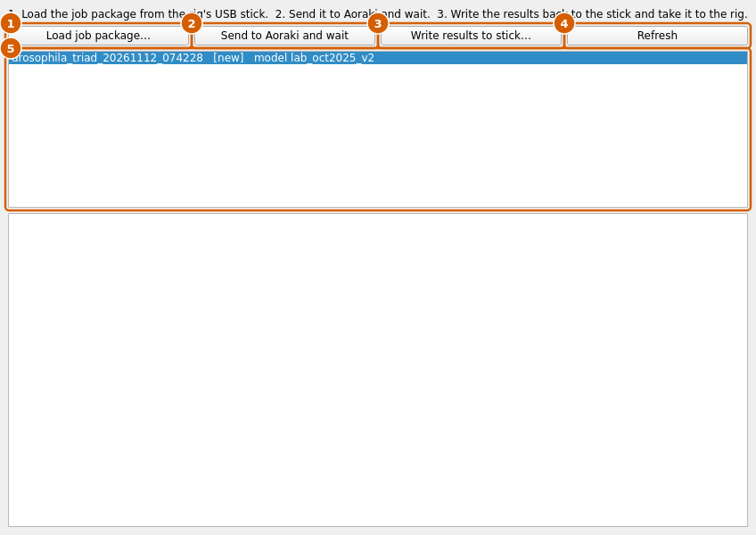

1. **Load job package…**: pick the `.job.zip` on the stick.
2. **Send to Aoraki and wait**: runs the Aoraki part for the session selected
   in the list.
3. **Write results to stick…**: writes `<session>.results.zip` to the stick.
4. **Refresh**: updates the list.
5. **Sessions**: each loaded job, with its state (*new*, *at …*, *results
   ready*) and model.

Back on the rig, Analyse page: **Import relay results…**, then **Send to Aoraki
and wait** to score them.

## Training-data wizard

The pose model learns from frames where people have placed every fly's body
points by hand. This wizard picks good frames to label, lets you label them in
SLEAP (here or on any Linux PC from a USB stick), checks the labels when they
come back, and trains a better model on Aoraki. All labelled frames live in a
**label set** with numbered versions.

### Start

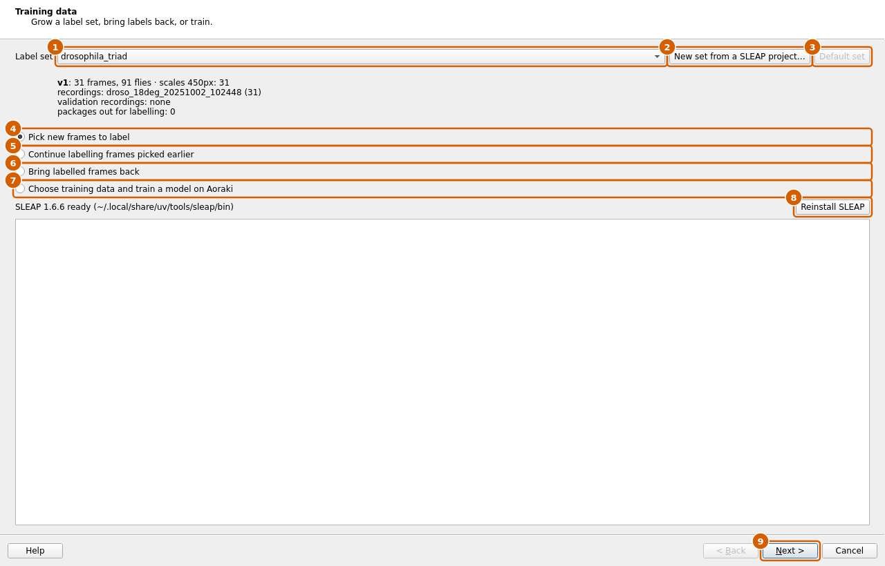

1. **Label set**: the set you work on. The lines under it show its frames,
   flies, camera scales, recordings and packages still out for labelling.
2. **New set from a SLEAP project…**: starts a new label set from a SLEAP file
   that is already labelled.
3. **Make default**: this set is picked automatically and is copied to Aoraki
   every 2 hours (the PC must stay logged in for that).
4. **Pick new frames to label**: go to *Recordings*.
5. **Continue labelling frames picked earlier**: go to *Continue labelling*.
6. **Bring labelled frames back**: go to *Bring labelled frames back*.
7. **Choose training data and train a model on Aoraki**: go to *Training
   data*.
8. **Set up SLEAP**: installs SLEAP for your user (no administrator needed).
   When SLEAP is installed, the line says *SLEAP 1.6.6 ready* and the button
   reads *Reinstall SLEAP*.
9. **Next**: opens the page chosen in 4–7.

### Pick new frames: Recordings

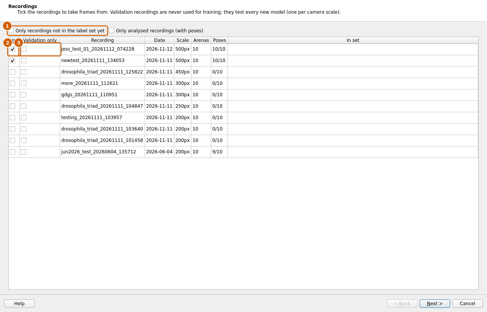

1. **Filters**: *Only recordings not in the label set yet* and *Only analysed
   recordings (with poses)*.
2. **Use**: tick the recordings to take frames from.
3. **Validation only**: this recording is never trained on; it only tests
   models. Pick one per camera scale (the *Scale* column).

### Pick new frames: Frames

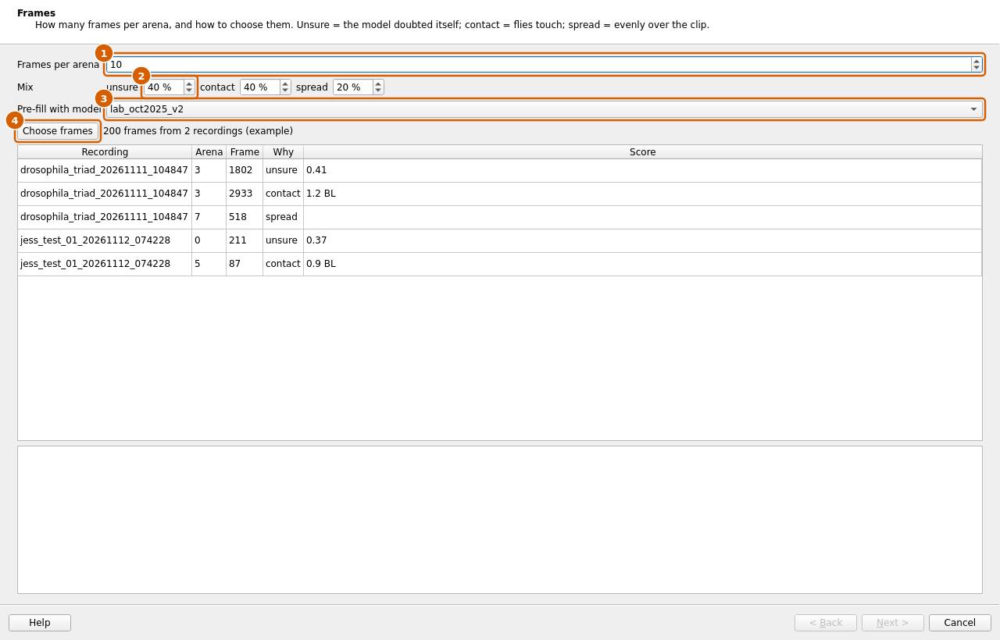

1. **Frames per arena**: how many frames to take from each arena.
2. **Mix**: how the frames are chosen. *unsure*: the model doubted itself;
   *contact*: the flies touch; *spread*: evenly over the clip. Frames are at least
   2 s apart and never frames already labelled.
3. **Pre-fill with model**: a model places its guess on every frame, so you
   only correct it. *none* gives empty frames.
4. **Choose frames**: picks the frames and lists them (recording, arena, frame,
   why, score).

### Pick new frames: Where to label

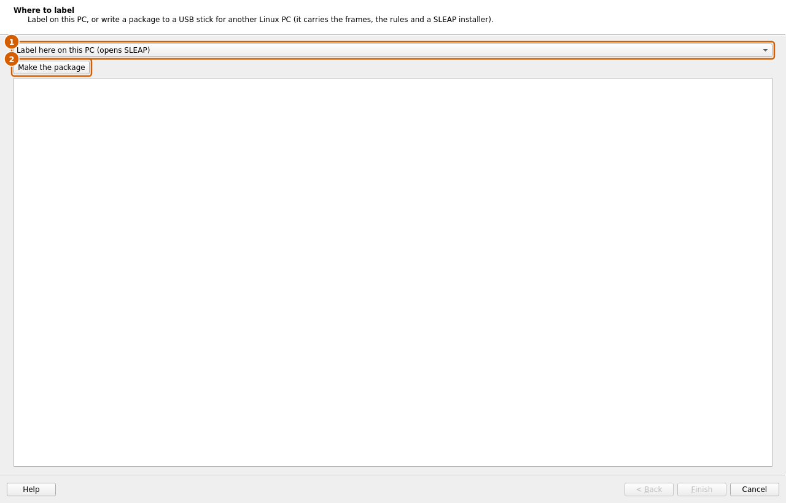

1. **Where to label**: *Label here on this PC* opens SLEAP; *USB stick: …*
   or *A folder…* writes a package.
2. **Make the package**: builds the package with the frames inside.

A package on a stick runs on any Linux PC: open the folder and run
`bash label.sh`. It installs SLEAP the first time, then opens the frames. Save
with **Ctrl+S**; the file on the stick is what comes back. `RULES.md` in the
package explains how to label.

### Continue labelling

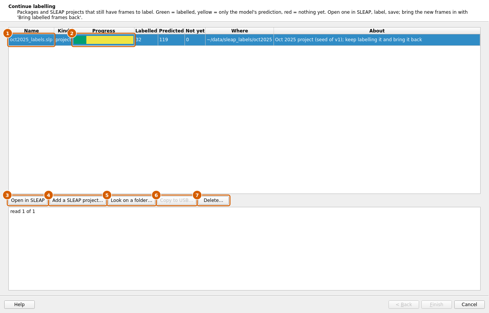

1. **List**: packages not brought back yet, and SLEAP projects labelled
   outside the wizard. *Where* says if it is on a stick or this PC.
2. **Progress bar**: green labelled, yellow only the model's guess, red
   nothing yet.
3. **Open in SLEAP**: opens the selected one (double-click works too).
4. **Add a SLEAP project…**: adds a SLEAP file labelled outside the wizard.
5. **Look on a folder…**: finds packages in a folder that is not listed.
6. **Copy to USB…**: copies the selected package, with what is labelled so
   far, to a stick or folder. If the stick already has a copy, you are warned
   before it is replaced. (SLEAP projects cannot be copied: they need their
   videos.)
7. **Delete…**: deletes a package and its copies on plugged-in sticks after a
   warning that lists what would be lost. If frames are labelled, you must type
   the package name. For a SLEAP project it only takes it off the list.

### Bring labelled frames back

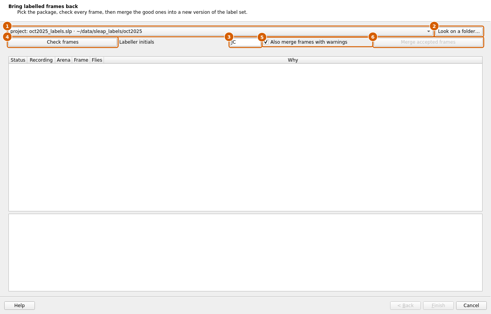

1. **Package or project**: what to take in. Packages on plugged-in sticks are
   listed by themselves.
2. **Look on a folder…**: finds a package somewhere else.
3. **Labeller initials**: who labelled the frames.
4. **Check frames**: checks every frame. *Rejected* frames are half-corrected,
   have the wrong number of flies, miss a thorax, have points off the image, or
   label one fly twice. The table says why for each frame.
5. **Also merge frames with warnings**: takes frames with only a warning too
   (for example the female head rule).
6. **Merge accepted frames**: adds the accepted frames to the label set as a
   new version. Frames already in the set are skipped.

### Training data

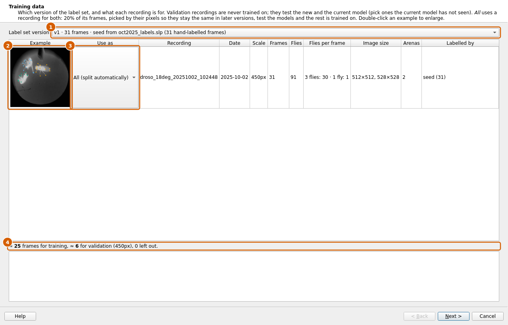

1. **Label set version**: which version to train on.
2. **Example**: one labelled frame of each recording. Double-click to
   enlarge it.
3. **Use as**: what each recording is for.
   - *Training*: trained on.
   - *All (split automatically)*: 20 % of its frames test the models, the rest
     is trained on. The same frames stay test frames in later versions.
   - *Validation*: only tests the models (best: a recording the current model
     has never seen).
   - *Leave out*: not used.
4. **Totals**: frames for training and for validation. **Next** needs both.

The other columns show date, camera scale, frames, flies, flies per frame,
image size, arenas and who labelled them.

### Train on Aoraki

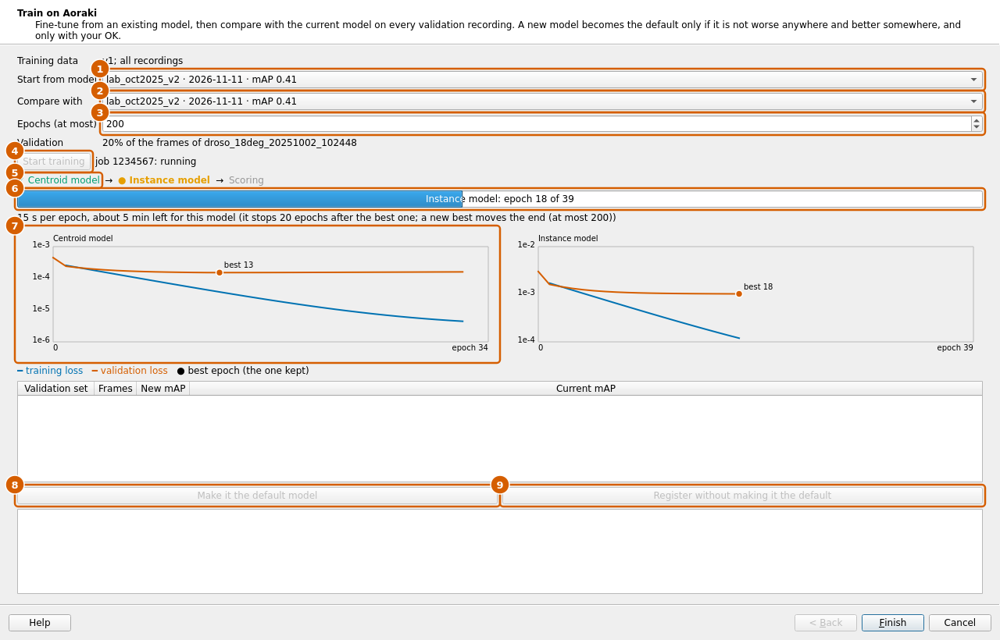

1. **Start from model**: the model the new one is trained from.
2. **Compare with**: the current model it must beat.
3. **Epochs (at most)**: the longest training; it stops earlier when the model
   stops improving.
4. **Start training**: sends the frames to Aoraki and starts training. You can
   close the wizard; it picks the run up again when reopened.
5. **Steps**: Aoraki trains two models one after the other (*Centroid model*
   finds the flies, *Instance model* places the points), then scores the new
   and the current model. Green ✓ is done, orange ● is running.
6. **Epoch bar**: epochs done for the model in training, and about how long
   is left. Training stops 20 epochs after the best epoch, so the end moves
   back each time the model gets better (never past *Epochs (at most)*). The
   page checks Aoraki every minute.
7. **Loss curves**: one per model. Blue is the training loss, orange the
   validation loss, the dot the best epoch (the model that is kept). Both
   should go down. If the blue line keeps falling while the orange one stays
   flat, the model is learning the training frames by heart: label more frames.
8. **Make it the default model**: offered only when the new model is not worse
   than the current one on any validation set and better on at least one. The
   table above shows both models' scores (mAP) per validation set.
9. **Register without making it the default**: keeps the model in the list
   without using it for new recordings.

## Annotating Drosophila triads in SLEAP

This chapter is for the person who labels the frames. You get a package from
the training-data wizard (on a USB stick or on this PC). Each frame shows one
arena with **3 flies**: two intact males and one decapitated female. You place
**13 points** on every fly. The pictures in this chapter are SLEAP 1.6 itself,
opened on frames from the label set.

### Opening the frames

On a stick: open the package folder and run `bash label.sh`. On this PC:
*Label here on this PC* or *Open in SLEAP* in the wizard. Both open SLEAP
with the frames of the package.

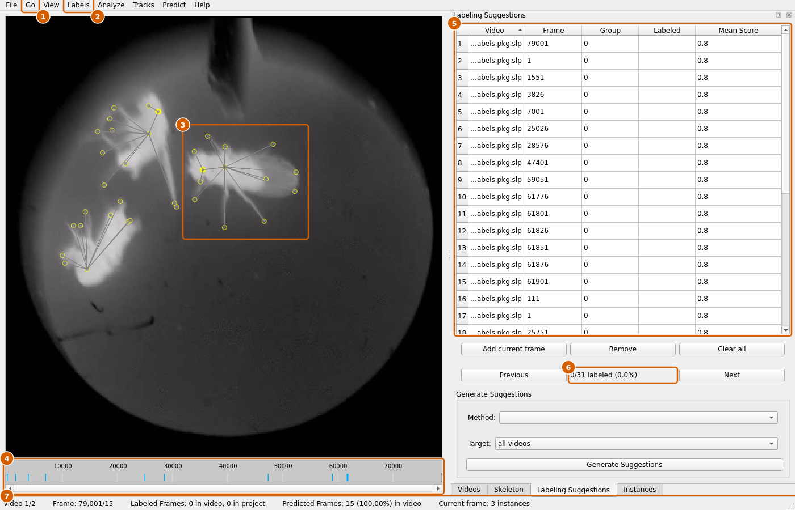

1. **Go**: *Next Suggestion* (**Space**) and *Previous Suggestion*
   (**Shift+Space**). This is how you move from frame to frame.
2. **Labels**: *Add Instance* (**Ctrl+I**) adds a fly; *Delete Instance*
   (**Ctrl+Backspace**) deletes the selected fly.
3. **A fly guessed by the model.** Guesses are drawn thin and yellow, without
   names. They are not labels yet.
4. **Seek bar**: the marks are the frames to label.
5. **Labeling Suggestions** tab: every row is one frame to label. Click a
   row to jump to it.
6. **Previous / Next** and the progress (*0/31 labeled*).
7. **Status bar**: frame number and how many flies are on it.

Do not use *Generate Suggestions*, *Add current frame*, *Remove* or *Clear all*:
the wizard has already chosen the frames.

### The 13 points

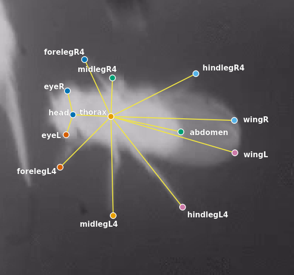

| Point | Where |
|---|---|
| head | middle of the head, between the eyes |
| eyeL, eyeR | the left and right eye |
| thorax | middle of the thorax. **Every fly needs it; be precise.** |
| abdomen | on the abdomen, towards its hind end (as in the picture) |
| wingL, wingR | the tip of the left and right wing |
| forelegL4, forelegR4 | the tip of the left and right front leg |
| midlegL4, midlegR4 | the tip of the left and right middle leg |
| hindlegL4, hindlegR4 | the tip of the left and right hind leg |

Left and right are always the **fly's own** left and right. Do not go by
which side of the screen the point is on. Look at where the head points.

### Correcting a fly the model guessed

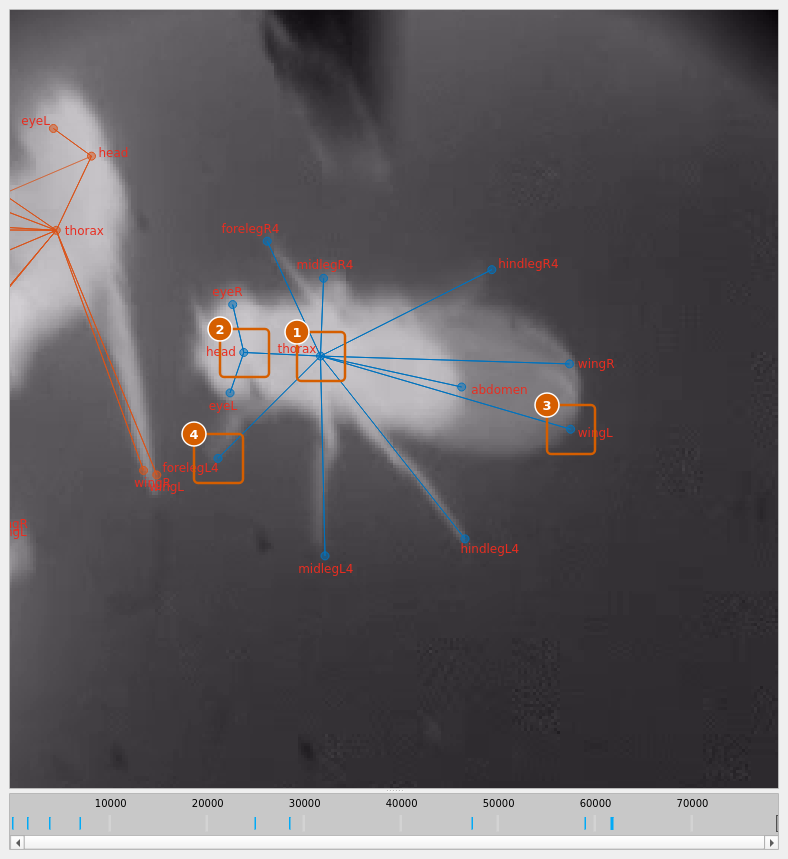

1. Press **Space** to go to the next frame to label.
2. **Double-click** a guessed fly. It becomes a labelled fly: coloured, with
   the name next to every point.
3. **Drag** every point that is wrong to the right place. Check all 13: the
   thorax (1), the head (2), the wing tips (3) and the leg tips (4).
4. A point you cannot see: **right-click** it. It turns grey (*not visible*).
   Right-click again to bring it back. Do not guess hidden leg tips.
5. The whole fly is in the wrong place: hold **Alt** and drag any point. Turn
   the mouse wheel while dragging to rotate the fly.
6. A guess that is not a fly, or a fly guessed twice: click it and press
   **Ctrl+Backspace**.
7. A fly with no guess: **Ctrl+I** adds a new fly. Drag its points into
   place.
8. Do this for all 3 flies, then press **Space** for the next frame.

**Zoom** with the mouse wheel. Hold **Alt** and drag a box to zoom into it;
**Alt + double-click** zooms out again. Drag with the left button to move
the picture.

### The female

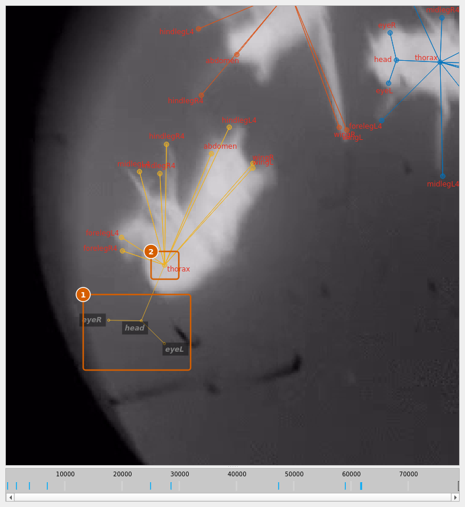

The female has no head. Still place **head, eyeL and eyeR** (1) where her head
would be, in front of the thorax (2). Then right-click each of the three so
they turn grey (*not visible*). Do not delete them. The wizard uses these
three grey points to know which fly is the female.

### Frame rules

- **Finish a frame or leave it alone.** If you correct one fly, correct all
  three. A frame with labelled and guessed flies mixed is rejected.
- **Exactly 3 flies** per frame. A fly that is out of the picture, or flies you
  cannot tell apart: skip the frame (press **Space**) and leave it as it is.
- Every fly needs a **thorax**.
- **No points outside the image.**
- **Never label one fly twice.** Two labelled flies on top of each other are
  rejected.
- The female must have grey head points. Otherwise the frame gets a warning
  and is merged only if *Also merge frames with warnings* is ticked.

When the frames come back, *Check frames* tests these rules (see *Bring
labelled frames back*).

### Saving and bringing the frames back

- Save often with **Ctrl+S**. Saving writes into the package itself.
- Do not use *Save As*, and do not rename or move `labels.pkg.slp`. The
  wizard knows every frame by its pixels and rejects frames it did not send.
- When you are done: save, close SLEAP and bring the stick back. In the
  wizard choose *Bring labelled frames back*.
- You do not have to finish in one go. Frames you skipped stay in the
  package; *Continue labelling* opens it again.

### SLEAP keys

| Key | What it does |
|---|---|
| Space / Shift+Space | next / previous frame to label |
| double-click a guess | turns the guess into a labelled fly |
| drag a point | moves the point |
| right-click a point | not visible ↔ visible |
| Alt + drag a point | moves the whole fly (wheel: rotate) |
| Ctrl+I | adds a fly |
| Ctrl+Backspace | deletes the selected fly |
| mouse wheel | zoom |
| Alt + double-click | zoom out completely |
| Ctrl+S | save |

## Command line

Everything in the windows can also be done in a terminal:

| Command | What it does |
|---|---|
| `rigconductor doctor` | the rig readiness check |
| `rigconductor sessions` | lists recording sessions |
| `rigconductor status SESSION_ID` | the steps done for one session |
| `rigconductor run SESSION.json` | runs the steps of a session |
| `rigconductor redo-cut SESSION_ID` | cuts a recording again |
| `rigconductor rerun SESSION_ID --model MODEL` | analyses again with another model |
| `rigconductor models --refresh` | fetches the model list |
| `rigconductor disks` | lists USB disks |
| `rigconductor ddb import` | DrosoDB from a USB stick |
| `rigconductor pack` / `import-results` | the Rig Relay steps on the rig |
| `rigconductor relay import / run / pack-results` | the Rig Relay steps on the relay |
| `rigconductor setup-sleap` | installs SLEAP for labelling |
| `rigconductor label-default [NAME]` | shows or sets the default label set |
| `rigconductor label-sync` | copies the default label set to Aoraki now |
| `rigconductor install-desktop` | adds the desktop icons |

`rigconductor COMMAND --help` lists the options of each command.

## Keeping this manual up to date

The pictures are made by `scripts/manual_screenshots.py` and the PDF by
`scripts/build_manual_pdf.py`. After a window changes, run both again (see the
top of each script). The SLEAP pictures are made by
`scripts/manual_sleap_screenshots.py`; it runs with SLEAP's own Python and a
labelled label set version.
